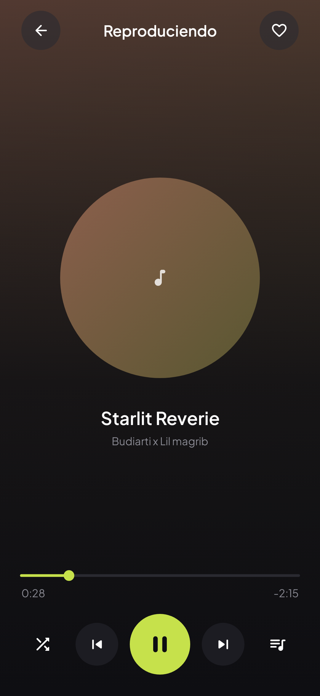

# Zenith

Reproductor de música para Android que reproduce **solo la música guardada en el teléfono**. No usa internet, no tiene cuentas ni streaming, y no recolecta datos. Su valor está en la experiencia: una interfaz oscura, moderna y fiel a un diseño de referencia.

<p align="center">
  
</p>

> **Estado:** en desarrollo. Hay 4 de 10 fases implementadas, que pasan los tests automáticos (88/88) pero **todavía no se han probado en un teléfono real**.

## Qué hace hoy

- **Mi Música:** pide el permiso de audio con una explicación clara y muestra todas las canciones del teléfono con su portada, que se actualizan solas si se añaden o borran archivos.
- **Reproducción en segundo plano:** sigue sonando con la pantalla bloqueada o en otra app.
  - Se controla desde la notificación, la pantalla de bloqueo y los auriculares.
  - Se pausa en llamadas y al desconectar los auriculares.
- **Pantalla Reproduciendo:**
  - portada circular sobre un fondo difuminado;
  - barra de progreso lima arrastrable;
  - aleatorio, repetir (manteniendo pulsado aleatorio) y una cola que se puede reordenar.
- **Navegación:** barra flotante con 5 pestañas (Inicio, Mi Música, Historial, Listas y Ajustes). Algunas pantallas aún son provisionales.

## Lo que falta

Mi Música con álbumes, artistas y carpetas · favoritos, listas e historial · pantalla Inicio con "Para ti" y búsqueda · mini reproductor y ajustes · letras sincronizadas (`.lrc`) · pulido final.

El detalle de las 10 fases y sus 66 tareas está en [doc/03-hoja-de-ruta.md](doc/03-hoja-de-ruta.md).

## Tecnologías

| Tema | Elección |
|---|---|
| Lenguaje y UI | Kotlin, Jetpack Compose y Material 3 (muy personalizado) |
| Reproducción | AndroidX Media3 (ExoPlayer + `MediaSessionService`) |
| Música | `MediaStore.Audio` del sistema (solo lectura) |
| Portadas | Coil 3, **sin** módulo de red |
| Arquitectura | MVVM + flujo de datos unidireccional, capas UI → Dominio → Datos |
| Inyección de dependencias | Hilt |
| Tests | JUnit, Robolectric, Compose UI Test y Konsist (vigila las capas) |
| Versiones | `minSdk 26` (Android 8.0) y `targetSdk 35` |

**Permisos:** leer audio (`READ_MEDIA_AUDIO` o `READ_EXTERNAL_STORAGE`) y los necesarios para el servicio de reproducción en primer plano. **Sin permiso de internet**: hay un test que lo comprueba.

## Compilar y probar

Hace falta el **JDK 21** (Java 25 no es compatible con esta versión de Gradle) y el Android SDK 35.

```bash
export JAVA_HOME="/ruta/al/jdk21"
./gradlew test             # tests unitarios y de interfaz (Robolectric)
./gradlew assembleDebug    # genera app/build/outputs/apk/debug/app-debug.apk
```

Instalar en un teléfono con la depuración USB activada:

```bash
adb install -r app/build/outputs/apk/debug/app-debug.apk
```

## Documentación

- [01-diseno.md](doc/01-diseno.md): qué es la app, pantallas, estilo y adaptación a música local.
- [02-arquitectura.md](doc/02-arquitectura.md): capas, reglas de dependencia y Konsist.
- [03-hoja-de-ruta.md](doc/03-hoja-de-ruta.md): fases y tareas.
- [04-bitacora.md](doc/04-bitacora.md): registro de avance y decisiones.
- [planes/](doc/planes): plan detallado de cada fase.
